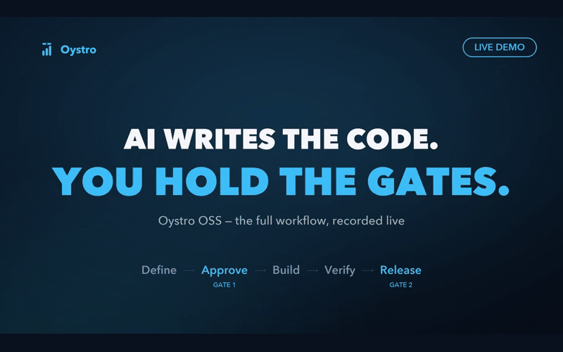

# oystro-oss

**An Agentic Development Lifecycle (ADLC) protocol for AI coding agents.**

**Website:** [oystro.com](https://oystro.com) · **User Guide:** [oystro.com/documentation](https://oystro.com/documentation)

One protocol. Any agent. Any project. From big picture to shipped feature — with human gates,
structured templates, and explicit phase transitions for large BRDs.

> This repository (`oystro-oss`) is the **free, open-source edition** of the protocol:
> conventions, templates, command contracts, and personas. The **Oystro Standard edition** (the
> paid version) adds enhanced features that enforce the workflow — prerequisite checks, evidence
> capture, dashboards, and memory and migrations.

---

## Quickstart

Open your AI agent in your project directory and paste this:

```
read https://github.com/oystro/oystro-oss/blob/main/commands/init.md and follow the instructions to initialize oystro-oss in this folder
```

| Folder state | What the agent does |
|--------------|---------------------|
| **Empty** | Asks questions, builds requirements from conversation |
| **Existing code** | Reverse-engineers BRD, constitution, architecture |
| **PRD + ADR ready** | Derives all documents from existing docs |
| **Has .oystro-oss/** | Refreshes the protocol, preserves customizations |



---

## Oystro OSS vs Standard

| Capability | This repo (oystro-oss) | Oystro Standard edition |
|---|---|---|
| Workflow, templates, gates, personas | Yes | Yes |
| Command contracts | Yes | Yes |
| Deterministic gate enforcement | — | Yes |
| Evidence capture and verification | — | Yes |
| Status dashboard and approvals | — | Yes |
| Memory, project graph, migrations | — | Yes |
| Multi-project / team workflows | — | Yes |

The Oystro-oss protocol is a **file-based convention**, not a tool dependency. It works whether you use
Claude, Copilot, or Opencode. The runtime is what makes it dependable.

---

## The Workflow

The core philosophy is a bounded agent loop: agents work autonomously, and human gates stop
them until a person approves.

```text
oystro:init → oystro:define → [Human Gate 1: oystro:approve] → oystro:build
        → [oystro:review-pre-verify — L only] → oystro:verify → [Human Gate 2: oystro:release]
```

`oystro:define` puts the design and the tasks into one `spec.yaml`. There are no separate design
or tasks commands.

A project has **phases**. A phase has **slices**. `define` starts a slice and adds it to the active
phase. The lifecycle above runs for each slice. `release` runs once per phase, after every slice
verifies, and archives the phase.

### Commands

Read the command contracts from `commands/` (installed projects: `.oystro-oss/commands/`).

| Command | Persona | What happens | Gate |
|---------|--------------|-------------|------|
| `oystro:init` | Collaborator | Scan docs, derive constitution/BRD/architecture, plan phases | — |
| `oystro:define` | Collaborator | Create `spec.yaml` from the BRD, including design and tasks | — |
| `oystro:approve` | Gatekeeper | **Human Gate 1** — approve the spec/design before build | Human |
| `oystro:build` | Developer | Implement against the approved Evidence Contract — one commit per task | — |
| `oystro:review-pre-verify` | Sr Tech Lead | Fresh-context review of build against the contract (**L only**) | Agent review |
| `oystro:verify` | Gatekeeper | Run approved evidence, check acceptance criteria, write verification | — |
| `oystro:release` | Gatekeeper | **Human Gate 2** — release the verified phase. Archive it with its slices, specs, and proof. | Human |
| `oystro:change` | Developer | Unified bug and CR workflow: baseline → approve → smallest delta → verify | Human |
| `oystro:status` | Collaborator | Project state snapshot (provided by the Oystro engine) | — |
| `oystro:upgrade` | Collaborator | Refresh the protocol; hand state to the Oystro Standard edition | — |

> Commands are written `oystro:<command>` — for example `oystro:define  <your intent>`. No leading slash.

---

## Workflow Levels (S / M / L)

The project sets one workflow level in `CONSTITUTION.md` (the master control); every spec is
created according to it.

| Level | Scope | Design + tasks | `review-pre-verify` | Evidence |
|-------|-------|:---:|:---:|---|
| **S** | Small, low-risk, easily reversible | skipped | — | Happy path or cheapest deterministic check |
| **M** | Standard feature | required | — | Full evidence contract |
| **L** | Large, higher-risk, or hard to reverse | required | required | Full evidence contract |

A level changes the ceremony only. It never changes the human gates. Approval applies to every
level and to every bug or CR. Only the L-level Sr Tech Lead `review-pre-verify` review is skipped
by S and M.

- **S** — `define` goes straight to the requirements and the acceptance criteria. `build`
  implements them directly, with no task list.
- **M** — the standard: the full design and the granular tasks.
- **L** — M, plus the Sr Tech Lead `review-pre-verify` review before verification.

> Separate from the **workflow level** there is a **Testing Level** — **Light**, **Standard**, or
> **Full** — set project-wide in `CONSTITUTION.md`, which governs the depth of the evidence required.

---

## What Gets Created

```
your-project/
├── AGENTS.md                    ← agent workflow rules
│
└── .oystro-oss/
    ├── CONSTITUTION.md          ← principles, rules, and project levels (never overwritten)
    ├── BRD.md                   ← business requirements (never overwritten)
    ├── ARCHITECTURE.md          ← system design (never overwritten)
    ├── technology.yaml          ← toolchain + tech decisions (never overwritten)
    ├── SLICE_LOG.md             ← build narrative
    ├── commands/                ← workflow command contracts
    ├── agents/                  ← persona definitions
    ├── templates/               ← feature and big-picture templates
    │
    ├── phases/
    │   ├── active/<phase>/features/<slice>/
    │   │   ├── spec.yaml            ← the slice contract
    │   │   ├── verification.md      ← the verdict
    │   │   └── proof.md             ← the raw evidence
    │   └── archive/<phase>/         ← a released phase (all its slices)
    └── specs/
        ├── active/              ← CRs and changes
        └── done/                ← released CRs and changes
```

---

## Gates

Two human gates apply: Gate 1 after define (approve a slice spec), Gate 2 before the phase release
(approve and archive the phase).

1. **Human Gate 1 — `oystro:approve`** (before build, per slice). The human approves
   `Ref: APPROVED` in `spec.yaml`. Do not build a slice before this.
2. **Human Gate 2 — `oystro:release`** (per phase). After every slice of a phase is verified, the
   human approves the phase. `release` merges the phase branch into the target branch and archives
   the whole phase with its slices, specs, and evidence. Do not release before this.

**Agent review (not a human gate) — `oystro:review-pre-verify`**: a Sr Tech Lead fresh-context review
of the build against the spec. It applies to **L-level projects only**; S and M skip it.

Quality comes from:
- **Templates** — constrain LLM output with structure
- **Constitution** — principles the agent must follow
- **Evidence contract** — the minimum proof required per change, enforced by the Oystro engine

---

## Git Branching

```
main                               ← protected
  ├── feature/<FID>-<slug>        ← oystro:define
  ├── change/CHG-NNN-<slug>       ← oystro:change
  └── hotfix/<id>-<slug>          ← emergency fix against main
```

Commit convention: `type(ID): description`

PR Rules:
- **Feature → Main**: `feat(<FID>): <title> [VERIFIED]`
- **Change → Main**: `fix(CHG-NNN): <title> [VERIFIED]`
- **Hotfix → Main**: `hotfix(HOT-NNN): <title> [P0]`

---

## Security & Pre-Commit Setup

To prevent accidental secret leaks, configure the repository git hooks:
```bash
git config core.hooksPath githooks
```
This hook blocks a sensitive filename and runs `gitleaks protect --staged`.

---

## License

Copyright (c) 2026 Oystro. See [NOTICE](NOTICE).

Licensed under the GNU Affero General Public License v3.0 only (`AGPL-3.0-only`). See [LICENSE](LICENSE).

See [DISCLAIMER.md](DISCLAIMER.md) for the warranty and liability disclaimer.
